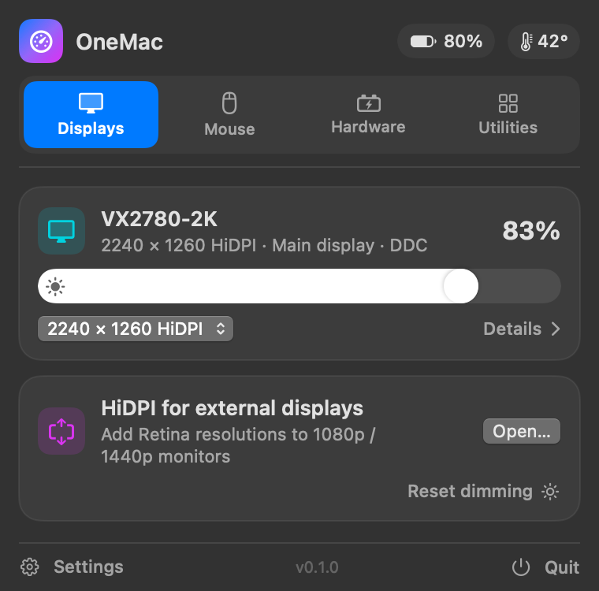
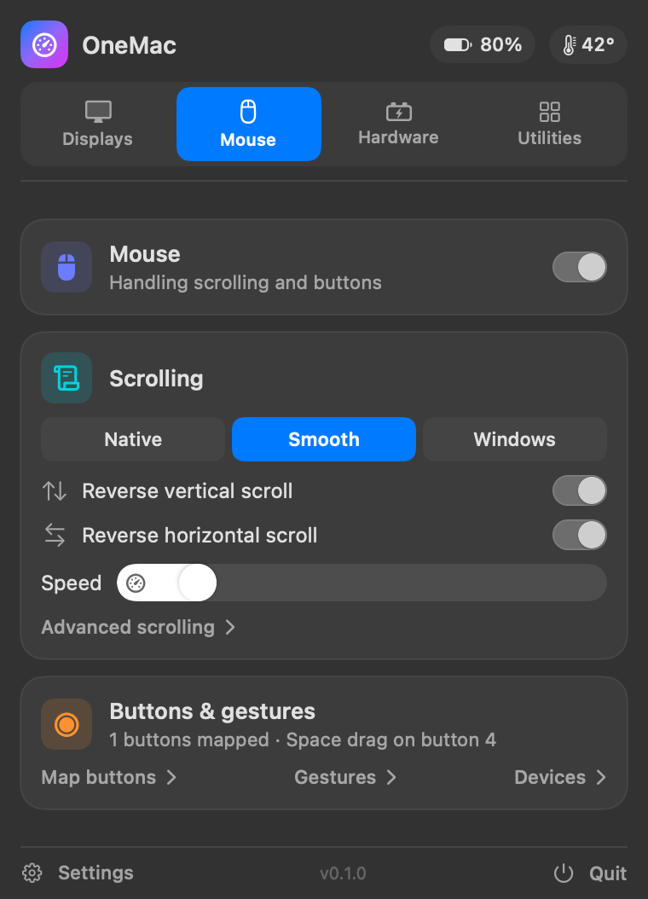
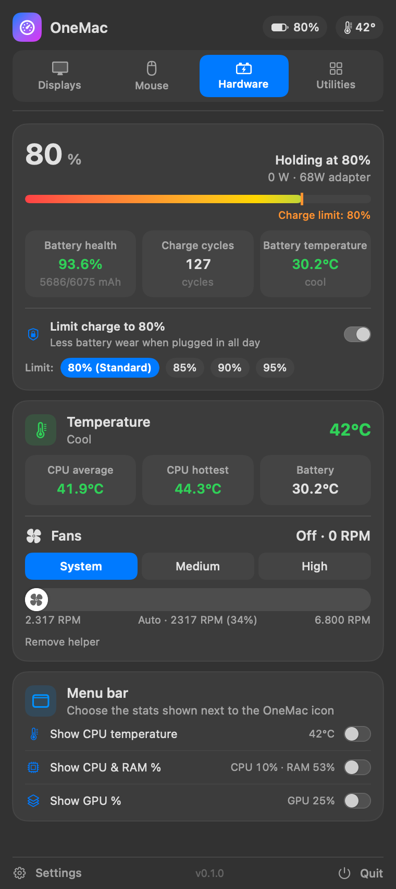
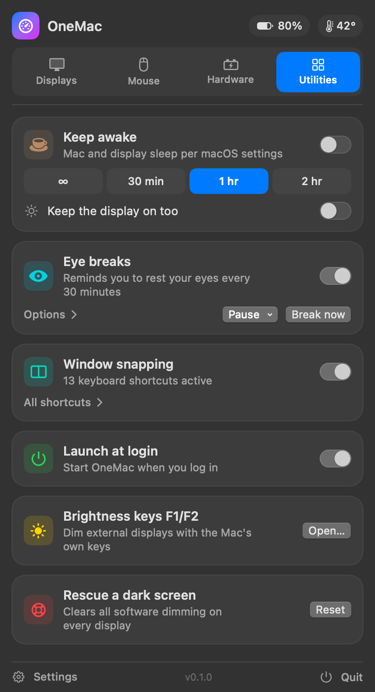

# OneMac

One menu-bar app for the small things macOS leaves out: external display brightness and HiDPI,
mouse tuning, window snapping, fans and battery, eye-break reminders, and a clipboard history.
English and Vietnamese UI.

Requires macOS 15 or later. Built and tested on Apple Silicon.

## Screenshots

| Displays | Mouse | Hardware | Utilities |
| :---: | :---: | :---: | :---: |
|  |  |  |  |

## Features

| Area | What it does |
| --- | --- |
| **Displays** | Brightness for external monitors (DDC, with gamma or shade dimming as fallback), brightness keys for the display under the pointer, resolution switching, per-display saved profiles. Monitor volume (slider and volume keys), contrast and input source over DDC. |
| **HiDPI** | Adds Retina (HiDPI) resolutions to 1080p / 1440p monitors through a display override, with a recovery package and one-click restore or removal. |
| **Mouse** | Smooth scrolling and scroll speed, zoom with ⌘ + wheel, button remapping and pairing, drag gestures between Spaces. |
| **Windows** | Snap windows to halves, quarters and zones by shortcut or by dragging; move windows between displays. |
| **Hardware** | Battery level, health and charge limit; temperatures; manual fan speed through a small root helper; keep-awake. CPU, RAM, GPU, network speed and free disk space next to the menu-bar icon. |
| **Eye breaks** | Timed rest reminders in four looks that rotate from break to break: two dim the screen slowly, two leave it usable. Breaks wait while media is playing. |
| **Clipboard** | History of copied text, links, images and files behind one shortcut (⇧⌘V by default): search, filter by type, preview, pin, paste. Off until switched on; skips copies that password managers mark as private. |

## Install

1. Download `OneMac.zip` from the [latest release](../../releases/latest) and unzip it.
2. Move `OneMac.app` to `/Applications`.
3. The app is signed with a local certificate, not notarized by Apple. On first launch, right-click
   the app and choose **Open**, or run:

   ```sh
   xattr -dr com.apple.quarantine /Applications/OneMac.app
   ```

To check the download, compare it with `OneMac.zip.sha256` from the same release:

```sh
shasum -a 256 -c OneMac.zip.sha256
```

### Permissions

- **Accessibility** — brightness and volume keys, mouse remapping, window snapping, and pasting straight
  from the clipboard history.
- **Administrator password** — only when installing a HiDPI override or the fan helper.

## Build from source

Needs Xcode (or the Swift 6 toolchain).

```sh
tools/setup-signing-cert.sh   # once: a stable local signing identity, so Accessibility survives rebuilds
./build-app.sh --install      # build, replace /Applications/OneMac.app and relaunch
swift test                    # run the tests
```

`tools/package-release.sh` builds the zip and its checksum; `--publish` also creates the GitHub release.

## Documentation

The display and HiDPI internals are documented in [`docs/hidisplay`](docs/hidisplay):

- [Architecture](docs/hidisplay/architecture.md)
- [DDC brightness](docs/hidisplay/ddc.md)
- [HiDPI overrides](docs/hidisplay/hidpi-overrides.md) and [recovery](docs/hidisplay/recovery.md)
- [Private APIs used](docs/hidisplay/private-apis.md) and [security notes](docs/hidisplay/security.md)
- [Source audit](docs/hidisplay/legal/source-audit.md) — which projects informed the code, and what was taken from each
- [Changelog](docs/hidisplay/project-changelog.md)

## Caveats

- OneMac uses undocumented macOS interfaces (DDC over IOAVService, SkyLight display modes, SMC fan
  control). A macOS update can break any of them; each one is optional and the matching feature hides
  itself when its interface is missing.
- A HiDPI override changes a system display file. Keep the recovery package the app creates.
- Manual fan control overrides the system's thermal management. Use it with care.

## License

[PolyForm Noncommercial 1.0.0](LICENSE.md). Free to use, modify and share for noncommercial purposes;
commercial use needs a separate license from the author.
